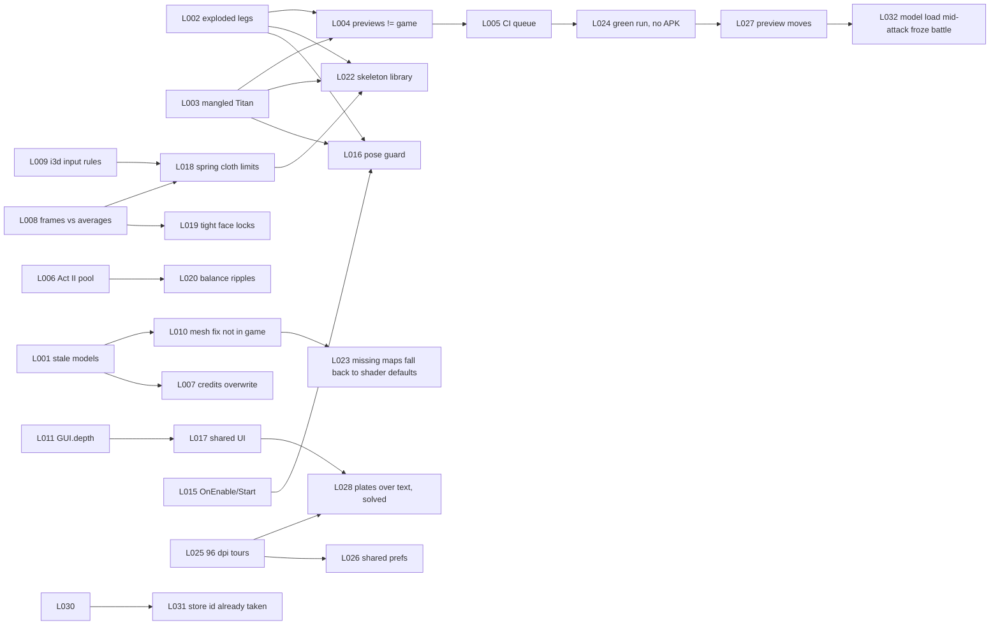

# Systems map

Which lessons belong to which system, and how systems connect. Read the rows for what you are about to touch.

| System | What it covers | Lessons |
|---|---|---|
| hero-models | GLBs, rigs, weights, meshes, materials | L002 L003 L004 L008 L010 L018 L019 L022 L023 |
| animation | clips, retargeting, Animation/Animator | L002 L003 L022 |
| rig-runtime | RigExtras, DigitigradeLegs, SpringBones, CreatureRig | L002 L003 L015 L022 |
| titan | Titan model, clips, TitanSpec, TitanBody | L003 L022 |
| art-pipeline | Gemini, cut-out, fal TRELLIS, artgen | L009 L012 |
| character-td | per-frame visual review method | L008 L018 L019 |
| build-pipeline | prepare-models, compress, credits | L001 L007 L010 |
| tests | Tests~, CompileCheck, gates | L001 L013 L026 L028 |
| ci | workflow, smoke gate, queue, artifacts | L004 L005 L016 L024 L027 |
| qa | in-house tester, checklists | L004 L016 L024 L025 L026 L027 L028 L032 |
| scenes | campaign scenery, cameras | L004 |
| balance | curves, pools, roles, probes | L006 L020 |
| campaign | stages, waves, eases | L006 |
| ui | IMGUI, shared components, overlays | L011 L017 L025 L028 |
| arena | ArenaReactor, effects | L015 |
| platform | Windows/Android specifics, app ids | L021 L031 |
| licensing | credits, licences | L007 |
| docs | changelog, PLAN, roadmap | L013 L029 L030 |
| process | who pushes, approvals | L014 L029 L030 L031 |
| tooling | keys, scripts | L012 |

